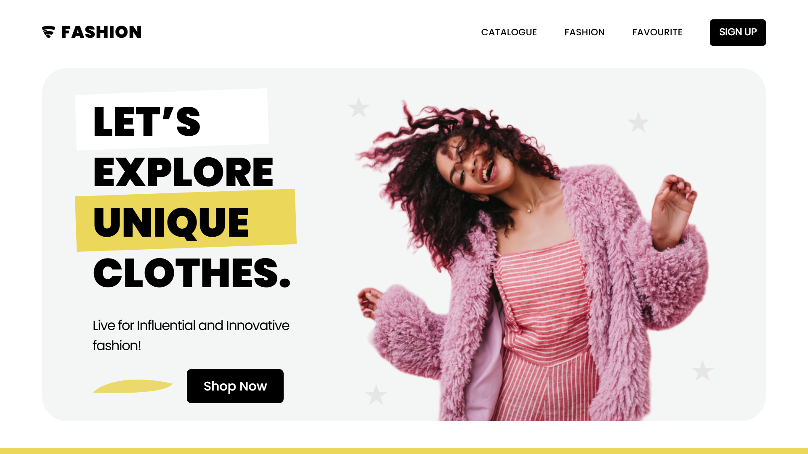
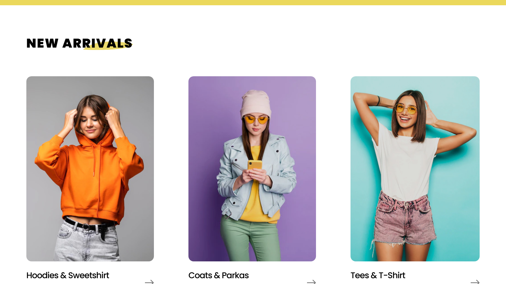
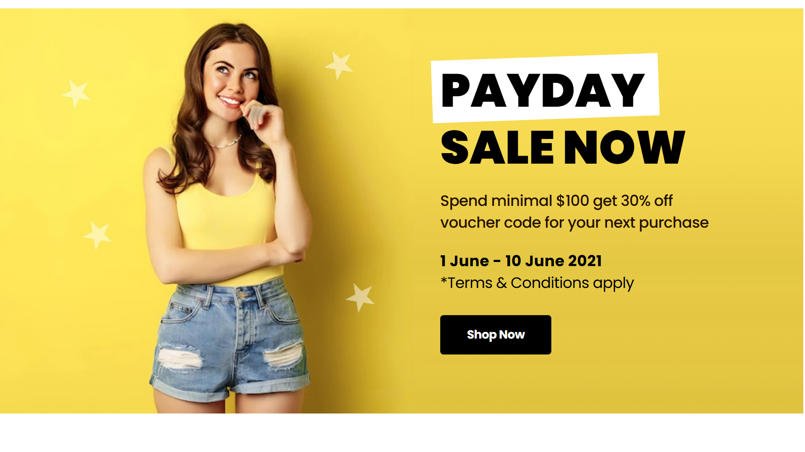
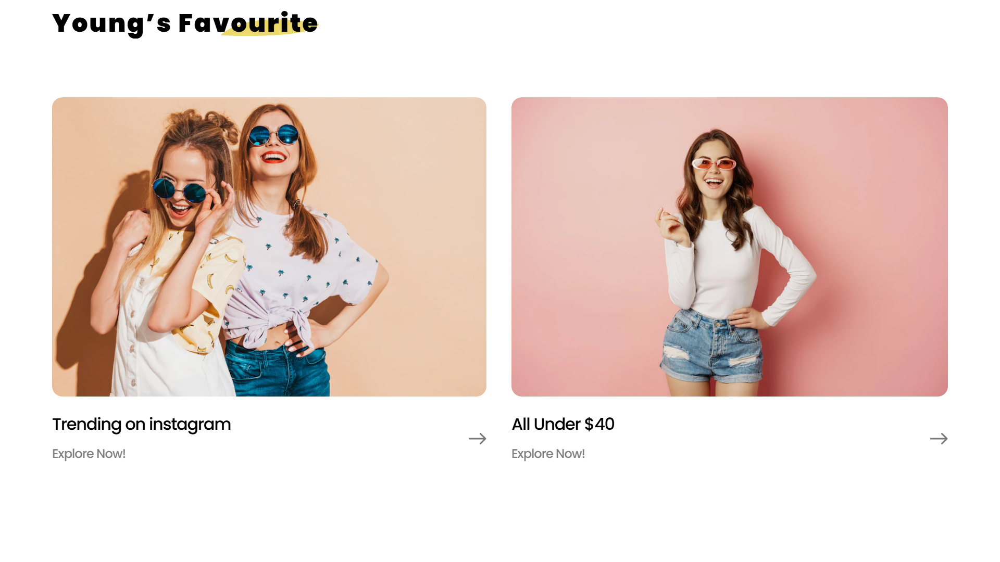
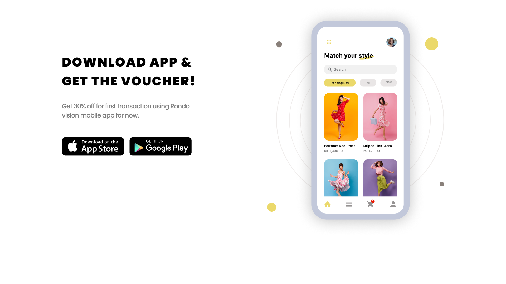
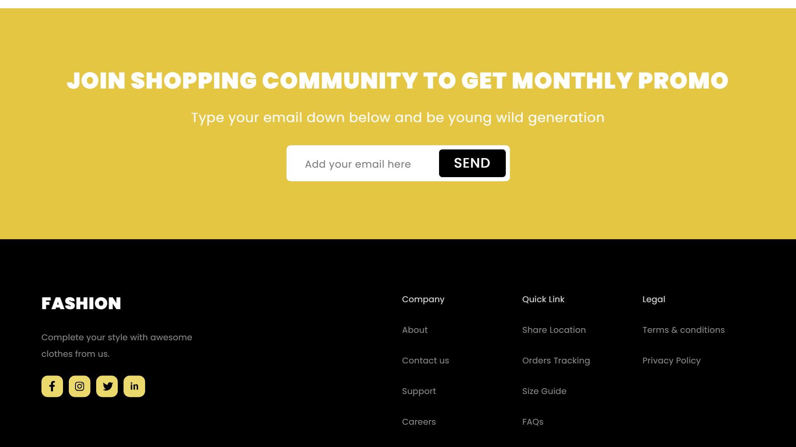

<h1 align="center">FashionStore</h1>

<p align="center">
  <b>Лендинг магазина одежды на React: бренды, новинки, распродажа, подборки и мобильное приложение.</b>
</p>

<p align="center">
  
  
  
  <a href="https://dekciw.github.io/FashionStore/"></a>
</p>

<p align="center">
  <a href="https://dekciw.github.io/FashionStore/">
    
  </a>
</p>

<br>

<p align="center">
  
</p>

<br>

<table align="center">
  <tr>
    <th>&#8199;&#8199;&#8199;&#8199;&#8199;&#8199;Разделы&#8199;&#8199;&#8199;&#8199;&#8199;&#8199;</th>
    <th>&#8199;&#8199;&#8199;&#8199;&#8199;&#8199;Акции&#8199;&#8199;&#8199;&#8199;&#8199;&#8199;</th>
    <th>&#8199;&#8199;&#8199;&#8199;&#8199;&#8199;Устройство&#8199;&#8199;&#8199;&#8199;&#8199;&#8199;</th>
  </tr>
  <tr>
    <td valign="top">
      - Промо с кнопкой Shop Now<br>
      - Логотипы брендов<br>
      - Новинки по категориям<br>
      - Подборки Young’s Favourite<br>
      - Подписка на промокоды<br>
      - Подвал со ссылками
    </td>
    <td valign="top">
      - Распродажа Payday Sale<br>
      - Скидка 30% от $100<br>
      - Подборка «всё до $40»<br>
      - Ваучер за приложение<br>
      - Кнопки App Store и Google Play<br>
      - Макет экрана приложения
    </td>
    <td valign="top">
      - 10 React-компонентов<br>
      - Общая карточка Card<br>
      - Свой CSS у компонента<br>
      - Шрифт Poppins<br>
      - Create React App<br>
      - Сайт на GitHub Pages
    </td>
  </tr>
</table>

<h3 align="center">Как это выглядит</h3>

<table align="center">
  <tr>
    <td width="50%" align="center" valign="top">
      <br>
      <sub>Новинки по категориям</sub>
    </td>
    <td width="50%" align="center" valign="top">
      <br>
      <sub>Распродажа</sub>
    </td>
  </tr>
  <tr>
    <td width="50%" align="center" valign="top">
      <br>
      <sub>Подборки</sub>
    </td>
    <td width="50%" align="center" valign="top">
      <br>
      <sub>Мобильное приложение</sub>
    </td>
  </tr>
  <tr>
    <td colspan="2" align="center" valign="top">
      <br>
      <sub>Подписка и подвал</sub>
    </td>
  </tr>
</table>

<br>

<details>
<summary><b>Подробнее о проекте: стек, устройство, запуск</b> (нажми, чтобы развернуть)</summary>

<br>

### Стек

<p>
- <b>Интерфейс:</b> React 19<br>
- <b>Сборка:</b> Create React App (react-scripts 5)<br>
- <b>Стили:</b> обычный CSS, у каждого компонента свой файл<br>
- <b>Шрифт:</b> Poppins из Google Fonts
</p>

### Устройство проекта

```
src/
├── App.js                  # собирает страницу из разделов
├── components/
│   ├── header/             # логотип, меню и кнопка Sign Up
│   ├── promo/              # первый экран
│   ├── brands/             # полоса с логотипами брендов
│   ├── arrivals/           # новинки по категориям
│   ├── card/               # карточка, используется в новинках и подборках
│   ├── sale/               # распродажа
│   ├── favorite/           # подборки
│   ├── app/                # мобильное приложение и ваучер
│   ├── community/          # подписка на промокоды
│   └── footer/             # подвал
├── image/                  # фото, иконки и логотипы брендов
└── styles/                 # сброс и общие стили
```

### Запуск

```bash
npm install
npm start          # dev-сервер на http://localhost:3000
npm run build      # сборка в папку build
```

</details>
